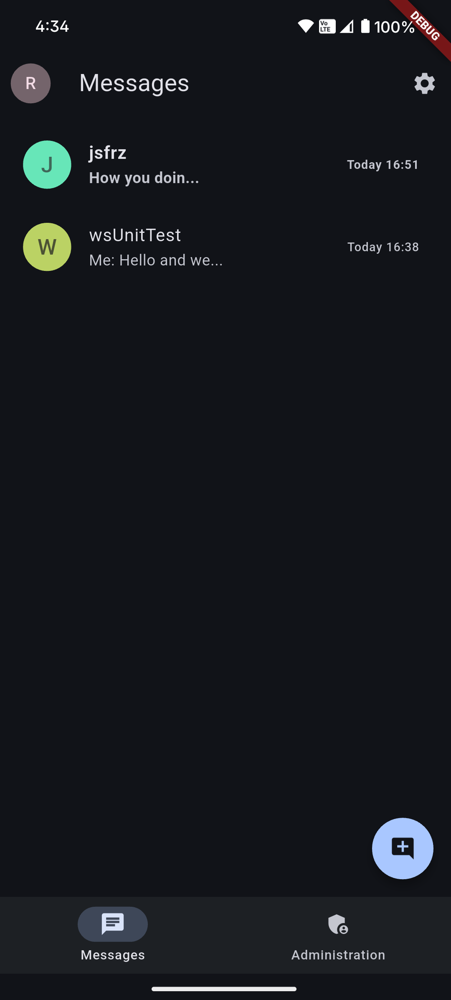
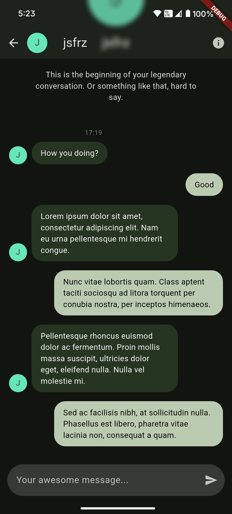
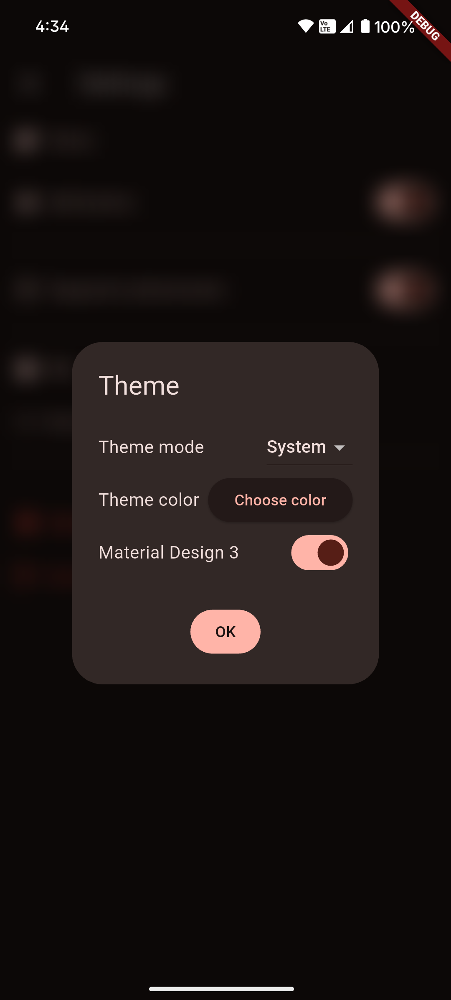

# whisper

Secure private self-hosted end-to-end encryption messaging app.

For Whisper server, see [whisper-server](https://github.com/jsfraz/whisper-server) repository.

Also see [Wiki](https://github.com/jsfraz/whisper/wiki)!

|   |   |   |
|---|---|---|
||||

## Download

You can download the app [here in the releases](https://github.com/jsfraz/whisper/releases).

## AI / MCP tooling

This project is developed with [OpenCode](https://opencode.ai). MCP servers are configured
globally in `~/.config/opencode/opencode.json` — there is no MCP config in this repository.

| Server | What it gives the agent |
|---|---|
| `dart` (official Dart & Flutter MCP server) | analyzer diagnostics, symbol resolution, tests, `pub`, hot reload/restart, DTD connection to a running app, widget inspector |
| `flutter-mcp-toolkit` | screenshots, semantic snapshot, tap/type, recent logs — UI verification against a running debug build |
| `context7` | library documentation lookup |

Pins: `dart mcp-server` comes with Dart 3.13.7; `flutter-mcp-toolkit` **v7.0.1** is the
linux-x64 release binary in `~/.local/bin` (sha256 verified against `checksums.txt`);
`mcp_toolkit` is pinned to **7.0.1** in `pubspec.yaml`. Releases 7.0.2 and 7.1.0 ship no
binaries yet, so upgrade the server and the package together.

```jsonc
"dart": {
  "type": "local",
  "command": ["dart", "mcp-server", "--enable", "all", "--disable", "create_project,dart_fix"]
},
"flutter-mcp-toolkit": {
  "type": "local",
  "command": ["flutter-mcp-toolkit-server", "--resources", "--images", "--save-images",
              "--no-dynamics", "--scan-ports", "8181"]
}
```

Verify with `opencode mcp list` (both `connected`); restart the session after config changes.
For a runtime session: `flutter run -d linux --device-vmservice-port=8181`, then discover the app
with `fmt_discover_debug_apps` and pass its `targetId`/`uri` to the toolkit tools.

Known limitations (Linux desktop, verified):
- Pixel capture is app-owned and off: `fmt_get_screenshots` / `fmt_capture_ui_snapshot` /
  `fmt_hot_reload_and_capture` return `visual_capture_unsupported` unless the app wires the
  optional permission bridge (`initializeFlutterPermissionToolkit`). Semantic snapshot, tap/type,
  logs and `fmt_hot_reload_flutter` work regardless.
- `fmt_evaluate_dart_expression` is denied in the OpenCode `permissions` config; the toolkit has
  no server flag for it, so the deny rule is the only enforcement.
- The toolkit only runs in debug builds and must never be used with a real account.

## Dependencies

- [basic_utils](https://pub.dev/packages/basic_utils)
  - used for cryptography
- [bcrypt](https://pub.dev/packages/bcrypt)
  - used for password hashing
- [crypto](https://pub.dev/packages/crypto)
  - used for cryptography
- [cryptography](https://pub.dev/packages/cryptography)
  - used for cryptography
- [dart_jsonwebtoken](https://pub.dev/packages/dart_jsonwebtoken)
  - used for JWT token handling
- [easy_localization](https://pub.dev/packages/easy_localization)
  - used for app internationalization
- [email_validator](https://pub.dev/packages/email_validator)
  - used for email format validation
- [flutter_colorpicker](https://pub.dev/packages/flutter_colorpicker)
  - used for color selection in UI
- [flutter_launcher_icons](https://pub.dev/packages/flutter_launcher_icons)
  - used for generating app icons
- [flutter_local_notifications](https://pub.dev/packages/flutter_local_notifications)
  - used for local push notifications
- [fluttertoast](https://pub.dev/packages/fluttertoast)
  - used for showing toast messages
- [hive](https://pub.dev/packages/hive)
  - used for local data storage
- [http](https://pub.dev/packages/http)
  - used for HTTP requests
- [json_annotation](https://pub.dev/packages/json_annotation)
  - used for JSON serialization annotations
- [jwt_decoder](https://pub.dev/packages/jwt_decoder)
  - used for JWT token decoding
- [local_auth](https://pub.dev/packages/local_auth)
  - used for biometric authentication
- [mobile_scanner](https://pub.dev/packages/mobile_scanner)
  - used for QR code scanning
- [page_transition](https://pub.dev/packages/page_transition)
  - used for custom page transitions
- [path_provider](https://pub.dev/packages/path_provider)
  - used for accessing device file system paths
- [pointycastle](https://pub.dev/packages/pointycastle)
  - used for cryptographic algorithms
- [provider](https://pub.dev/packages/provider)
  - used for state management
- [qr_code_scanner_plus](https://pub.dev/packages/qr_code_scanner_plus)
  - used for enhanced QR code scanning
- [sprintf](https://pub.dev/packages/sprintf)
  - used for string formatting
- [url_launcher](https://pub.dev/packages/url_launcher)
  - used for launching URLs
- [vibration](https://pub.dev/packages/vibration)
  - used for device vibration feedback
- [whisper_openapi_client_dart](https://github.com/jsfraz/whisper_openapi_client_dart)
  - used for API communication with Whisper server
- [whisper_websocket_client_dart](https://github.com/jsfraz/whisper_websocket_client_dart)
  - used for real-time WebSocket communication with Whisper server

### Dev dependencies

- [flutter_test](https://flutter.dev/docs/testing)
  - used for unit and widget testing
- [flutter_lints](https://pub.dev/packages/flutter_lints)
  - used for code linting and style enforcement
- [hive_generator](https://pub.dev/packages/hive_generator)
  - used for generating Hive type adapters
- [build_runner](https://pub.dev/packages/build_runner)
  - used for code generation
  - run `dart run build_runner build` to generate code+
- [json_serializable](https://pub.dev/packages/json_serializable)
  - used for generating JSON serialization code

### Other

- [flutter_launcher_icons](https://pub.dev/packages/flutter_launcher_icons)
  - used for generating app icons
  - run `dart run flutter_launcher_icons` to generate icons
  - see configuration file [flutter_launcher_icons.yaml](flutter_launcher_icons.yaml)

## Firebase Messaging

- [Firebase](https://firebase.google.com/)
  - used for push notifications when user is offline
  - see [Firebase setup for Flutter](https://firebase.google.com/docs/flutter/setup) and [Firebase Cloud Messaging for Flutter](https://firebase.google.com/docs/cloud-messaging/flutter/client) for more details how to implement this
  - app specific configuration files [are not included](.gitignore) in the repository, you need to create them yourself if you plan self host Whisper (refer to [whisper-server](https://github.com/jsfraz/whisper-server) repository for more details)

### Development

To setup Firebase using Flutterfire you can run:

```bash
flutterfire configure
```

Or run this for the development environment:

```bash
flutterfire configure \
  --android-package-name cz.josefraz.whisper.debug \
  --ios-bundle-id cz.josefraz.whisper.debug
```

Then select your Firebase project. This will generate the necessary `firebase.json` and `lib/firebase_options.dart` files.

## Continuous Integration and Deployment (CI/CD)

Two GitHub Actions workflows run in this repository:

- `flutter-ci.yml` — on pull requests and on pushes to `main`: format check on changed files, `flutter analyze`, `flutter test`, secret scan.
- `build_and_release.yml` — on pushes to `main`: builds the release APK and publishes a GitHub Release tagged `v<version>`, where the version comes from `pubspec.yaml`.

Required repository secrets (Settings > Secrets and variables > Actions):

| Secret | Used by | Description |
| --- | --- | --- |
| `FIREBASE_OPTIONS_DART_BASE64` | `flutter-ci.yml`, `build_and_release.yml` | base64 of `lib/firebase_options.dart`. Required: analysis fails without it. |
| `FIREBASE_JSON_BASE64` | `build_and_release.yml` | base64 of `firebase.json`. |
| `GOOGLE_SERVICES_JSON_BASE64` | `build_and_release.yml` | base64 of `android/app/google-services.json`. |
| `GOOGLE_SERVICE_INFO_PLIST_BASE64` | not wired yet | base64 of `ios/Runner/GoogleService-Info.plist`. Add it to the build before shipping iOS releases. |
| `GITHUB_TOKEN` | both | Provided automatically by GitHub. Used by the secret scan. |

### Release signing

Release builds are signed with the debug key unless `android/key.properties`
exists (copy `android/key.properties.example`). A keystore is never committed:

```bash
keytool -genkeypair -v -keystore whisper-release.jks -keyalg RSA -keysize 4096 \
  -validity 10000 -alias whisper
cp android/key.properties.example android/key.properties   # then fill it in
```

CI has no keystore, so the APK it publishes is debug-signed; add the keystore as
a secret and decode it in the workflow before shipping real releases. The
release workflow fails when the `v<version>` tag for the current
`pubspec.yaml` version already exists, which is the reminder to bump `version`
(and the build number after `+`) before every release.

iOS push notifications need the *Push Notifications* capability on the
`cz.josefraz.whisper` App ID; `ios/Runner/Runner.entitlements` is already wired
into the project.

Pull requests from forks cannot read repository secrets, so CI is skipped for them.

These files are not included in the repository for security reasons. The base64 encoding ensures safe transmission and prevents issues with special characters.


### Procedure for setting up CI/CD

1. In the repository, go to Settings > Secrets and variables > Actions
2. For each configuration file, encode it to base64 format:
   - **Linux/macOS**: `base64 -w 0 < firebase.json` (copy the output)
   - **Windows**: `[Convert]::ToBase64String([IO.File]::ReadAllBytes("firebase.json"))` (in PowerShell)
3. Click on "New repository secret" for each of the secret keys listed above
4. Paste the base64 encoded content as the secret key value

After setting these secret keys, the workflow will automatically build the APK on every push to the `main` branch and create a new GitHub Release with the version according to `pubspec.yaml`.
